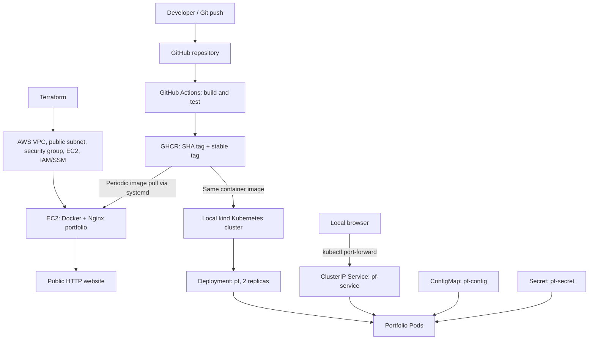

# AWS DevOps Portfolio — Terraform, Docker, CI/CD & Kubernetes

A hands-on DevOps project that builds and publishes a containerized portfolio website, provisions AWS infrastructure with Terraform, deploys the website to Amazon EC2, and practices Kubernetes operations in a local kind cluster.

> **Architecture note:** The public website runs in **Docker on AWS EC2**. Kubernetes runs **locally with kind on Docker Desktop** as a separate learning environment. This project does **not** use Amazon EKS or host Kubernetes on AWS.

## Project outcomes

- Built a static portfolio website served by Nginx in a Docker container.
- Implemented GitHub Actions CI to build an image, start a test container, and verify the HTTP response.
- Published Docker images to GitHub Container Registry (GHCR) using commit-SHA tags and a moving `stable` tag.
- Provisioned AWS networking and an EC2 instance using Terraform.
- Deployed the GHCR image to EC2 and set up periodic update checks using a systemd service and timer.
- Deployed the same image to a local Kubernetes cluster and practiced Services, probes, ConfigMaps, Secrets, scaling, self-healing, rolling updates, and rollback.

## Technology stack

| Area | Tools |
| --- | --- |
| Version control | Git, GitHub |
| Continuous integration | GitHub Actions |
| Containers and registry | Docker, Nginx, GHCR |
| Infrastructure as Code | Terraform, AWS provider |
| AWS | EC2, VPC, subnet, internet gateway, route table, security group, IAM instance profile, Systems Manager |
| Deployment automation | Bash, systemd service and timer |
| Kubernetes lab | kind, kubectl, Docker Desktop |
| Local development | Windows 11, PowerShell, VS Code |

## Architecture



**Note:** The two deployments are independent. The EC2 systemd script manages a Docker container; it does not deploy Kubernetes workloads. A push to GitHub is not automatically rolled out to the local kind cluster.

## Repository structure

```text
.
├── .github/
│   └── workflows/
│       └── ci.yaml
├── app/                  # Portfolio HTML, CSS, JS and assets
├── terraform/            # AWS infrastructure as code
├── k8s/
│   ├── deployment.yaml
│   ├── service.yaml
│   ├── configmap.yaml
│   └── secret.yaml        # Local training only; do not commit credentials
├── Dockerfile
└── README.md
```

> Directory paths reflect the project layout used in the lab. The Secret manifest should be kept out of source control even when it contains only training values. If a local `k8s/secret.yaml` is present, ensure Git ignores it.

## 1. CI pipeline and container registry

The workflow in `.github/workflows/ci.yaml` runs on pushes to `main` and can also be started manually. Its sequence is:

1. Check out the repository.
2. Build the portfolio Docker image.
3. Run a temporary Nginx test container.
4. Test the website with `curl`.
5. Authenticate to GHCR using GitHub Actions credentials.
6. Publish the image using the Git commit SHA and `stable` tags.

Image used by the deployments:

```text
ghcr.io/jubz33/portfolio-image:stable
```

The SHA tag provides a traceable image version; `stable` is a moving tag used by the EC2 pull-based deployment script. Publishing a tag does not by itself prove that either running environment has been updated.

## 2. AWS infrastructure with Terraform

The AWS deployment was built in the **Sydney region (`ap-southeast-2`)**. Terraform provisions:

- A VPC (`10.0.0.0/16`) and public subnet (`10.0.1.0/24`).
- An internet gateway, route table, and route-table association.
- A security group allowing inbound HTTP on port 80.
- An Amazon Linux 2023 EC2 instance (`t3.micro` during the lab).
- An IAM instance profile for AWS Systems Manager Session Manager.
- An encrypted 8 GiB gp3 root volume.

The EC2 instance is managed through **Systems Manager Session Manager**, without enabling public SSH access.

From the `terraform/` directory, the standard Terraform workflow is:

```powershell
terraform init
terraform fmt
terraform validate
terraform plan
terraform apply
```

Review the plan and costs before applying. Region, credentials, state configuration, and resource names must match your own AWS environment. Never commit AWS credentials, local state, or sensitive `.tfvars` files.

## 3. EC2 Docker deployment and automated update checks

The public site runs in a Docker container named `portfolio`, serving Nginx on EC2 port 80. The EC2 host has a Bash deployment script at:

```text
/usr/local/bin/deploy-portfolio.sh
```

The script pulls `ghcr.io/jubz33/portfolio-image:stable`, compares the pulled image with the running container image, and skips deployment when unchanged. On an image change it replaces the container, performs a local HTTP check, and has a rollback path for failures. A file lock avoids overlapping runs.

Automation is configured with:

```text
/etc/systemd/system/deploy-portfolio.service
/etc/systemd/system/deploy-portfolio.timer
```

The timer is configured to start shortly after boot and to recheck approximately five minutes after the previous service run becomes inactive. **It runs only while the EC2 instance is powered on.**

Useful verification commands on EC2:

```bash
sudo systemctl status deploy-portfolio.timer --no-pager
sudo journalctl -u deploy-portfolio.service -b -n 30 --no-pager
sudo docker ps
curl -fsS http://localhost:80/
```

**What was verified:** The deployment script completed a manual deployment and a no-update check; the systemd timer triggered successfully and resumed after an EC2 reboot. A brand-new Git push followed through to an unattended EC2 replacement has **not** been demonstrated end to end in the recorded lab.

## 4. Local Kubernetes deployment with kind

The Kubernetes lab runs on Windows with Docker Desktop and kind, using a cluster named `devop-proj`.

The manifests are kept under `k8s/`:

| Manifest | Role |
| --- | --- |
| `deployment.yaml` | Deployment `pf`, two replicas, Nginx image, CPU/memory limits, health probes and environment references |
| `service.yaml` | ClusterIP Service `pf-service` on port 80 |
| `configmap.yaml` | Non-sensitive environment configuration in `pf-config` |
| `secret.yaml` | Local-only training Secret `pf-secret`; not for source control |

The Deployment uses:

- Image: `ghcr.io/jubz33/portfolio-image:stable`
- Replicas: **2** in the saved manifest
- Container: `pf-container`
- Resource limits: `500m` CPU and `128Mi` memory
- Readiness: HTTP `GET /` on port 80, initial delay 5 seconds, period 10 seconds
- Liveness: HTTP `GET /` on port 80, initial delay 15 seconds, period 20 seconds
- `envFrom` to load `pf-config`
- `env` / `secretKeyRef` to populate `DB_USERNAME` from `pf-secret` key `username`

### Deploy locally

Prerequisites: Docker Desktop, `kind`, `kubectl`, and access to the container image.

```powershell
kind create cluster --name devop-proj
kubectl config use-context kind-devop-proj
kubectl apply -f k8s/configmap.yaml
# Create pf-secret locally before applying the Deployment.
kubectl apply -f k8s/service.yaml
kubectl apply -f k8s/deployment.yaml
kubectl rollout status deployment/pf
kubectl get pods -l app=pf
kubectl get endpointslices -l kubernetes.io/service-name=pf-service
```

For the **training-only** Secret, create the local manifest using the agreed demo credentials (`username: demo-user`, `password: demo-pass-123`), then apply it with `kubectl apply -f k8s/secret.yaml`. Do not use real credentials or commit that file. For real workloads, use a managed secret workflow and appropriate RBAC/encryption controls.

Access the local site:

```powershell
kubectl port-forward service/pf-service 8080:80
```

Open `http://localhost:8080`, then press `Ctrl+C` to stop port forwarding.

### Kubernetes operations practiced

- **Service discovery:** Fixed an empty EndpointSlice by matching the Service selector `app=pf` to the newly applied Deployment's Pod labels.
- **Scaling:** Used `kubectl scale --replicas=3 deployment/pf` and verified three running Pods.
- **Self-healing:** Deleted one Pod and observed the Deployment/ReplicaSet create a replacement.
- **Rollout history and rollback:** Inspected revisions, rolled back to revision 3, verified rollout, and reapplied the saved manifest to restore the Secret reference.
- **Final state:** Verified a successful rollout and returned to two replicas as declared in `deployment.yaml`.

Useful commands:

```powershell
kubectl get all
kubectl describe deployment pf
kubectl rollout history deployment/pf
kubectl rollout status deployment/pf
kubectl get pods -l app=pf
```

## Testing and evidence

| Test | Observed result |
| --- | --- |
| GitHub Actions build and HTTP test | Passed in the lab |
| GHCR image publication | Completed |
| Terraform validation and AWS provisioning | Completed |
| EC2 HTTP website access | Confirmed working |
| EC2 systemd scheduled image check | Completed successfully |
| Local kind Deployment | Two Ready Pods confirmed |
| ClusterIP Service discovery | Endpoints populated after label correction |
| Local website via port-forward | Confirmed working |
| ConfigMap environment variable injection | Verified inside container |
| Secret username injection | Verified inside container |
| Kubernetes scaling and Pod replacement | Verified |
| Kubernetes rollback and restoration | Verified |

Screenshots worth adding to a portfolio: GitHub Actions successful run, GHCR package, Terraform resources/plan with account details hidden, EC2 website in browser, systemd deployment logs, Kubernetes Pod/Service status, and rollout history.

## Security, cost and limitations

- This is a **hands-on learning project**, not a production-hardened deployment.
- The public EC2 site currently uses **HTTP**, not HTTPS; there is no custom domain or TLS termination in the documented setup.
- The AWS EC2 server runs **Docker directly**; AWS-hosted Kubernetes/EKS is **not** implemented.
- The local Kubernetes `ClusterIP` Service requires port forwarding for browser access outside the cluster.
- The deployment image uses a moving `stable` tag; explicitly versioned releases or pinned digests would improve reproducibility.
- The static Nginx site does not inherently consume the injected training configuration or database username.
- Do not commit real credentials, Kubernetes Secrets, AWS tokens, or unredacted infrastructure outputs.
- EC2 compute charges accrue while running; EBS and other resources may cost money even when the instance is stopped. Check AWS billing and destroy unused lab resources carefully.
- Public IP addresses can change after stopping and restarting an EC2 instance; avoid treating a temporary IP as a permanent project URL.

## Future improvements (optional)

- Add HTTPS using a custom domain and certificate.
- Pin images to immutable release tags or digests.
- Add image update automation for Kubernetes (distinct from the EC2 Docker timer).
- Introduce a safe secrets workflow and stronger runtime security settings.
- Consider an appropriately sized AWS Kubernetes environment only when budget and learning goals justify it.

## Author

Built as a practical DevOps learning and portfolio project. See [GitHub profile](https://github.com/jubz33) for source code and related projects.
